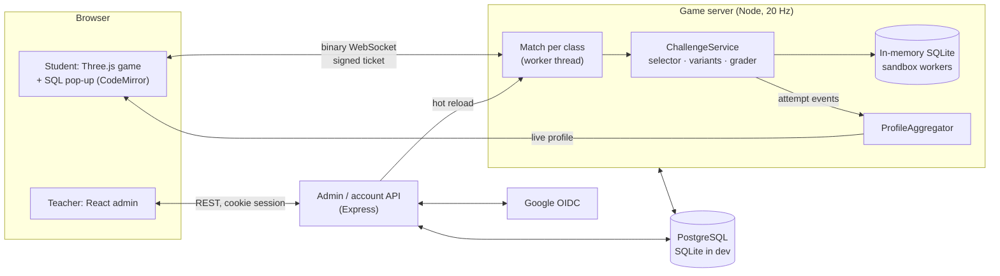

# SQL Heist City

**A 100-player browser heist game where the only way to open a vault, heal or earn a gun is to write the correct SQL, while your classmates are shooting at you.**

Underneath the game is an assessment engine. It scores every query against five learning dimensions and puts each student's profile on a live radar chart for them and their teacher.

> You're on the third floor of Metro Capital with 40 HP. The vault's second lock needs a `GROUP BY … HAVING`, someone is coming up the stairs, and the heal question is a `LEFT JOIN` you know you can do in 20 seconds. The world doesn't pause. **What do you solve first?**

That decision is the product. It turns SQL practice into something students choose to do under pressure, and it gives teachers evidence of what each student can actually do, not a single percentage.

---

## Why it exists

Most coding education still runs on static content: watch, read, take a quiz, get a score. The score says *how much* a student got right. It doesn't say *what kind* of thinking they can do: recall syntax, read someone else's query, solve a defined problem, build something open-ended, or choose between trade-offs.

SQL Heist City is built on one thesis: **learning should be practice that students want to do, with measurement that teachers can act on. AI speeds up the building, and accountable humans keep the decisions.**

## What's built today

The project went from an empty repository to the state below in 14 days (2–15 Oct 2026), across 17 completed phases and 391 small commits. Every status here is tracked in [docs/Phases.md](docs/Phases.md).

| Area | Status | What exists |
|---|---|---|
| **Multiplayer game** | ✅ Built | Third-person 3D city made from a seed, with 5 multi-floor banks, cars, 5 guns, day/night, bounties, round awards and a tutorial. Server-authoritative netcode with prediction and lag compensation. |
| **Question engine** | ✅ Built | 268 questions in 10 task kinds. Every question is a template seeded per player, so two students never get the same tables and copied answers don't work. Answers are graded in a locked-down in-memory SQLite sandbox. |
| **Learning analytics** | ✅ Built | Every item is tagged with RCSBE and Bloom. Scores pool marks across items, with rules for hints, abandoned questions and deaths. Live radars for students and teachers, a remediation signal and per-question item analysis. |
| **Teaching loop** | ✅ Built | Hint ladder, plain-language explanations of SQL errors, 57 concept cards, a post-round review, difficulty that follows each student's mastery, spaced repetition, a solo practice mode and pre/post tests. |
| **Classroom mode** | ✅ Built | Google sign-in, join by class code, one isolated match per class, a question set chosen per class, live teacher controls and stored results. |
| **Security hardening** | 🟨 Partial | Origin allow-list done. Rate limits, anti-cheat, sandbox fuzzing and an external pen test are still to do. |
| **Pilot and launch** | ⬜ Next | Not yet deployed or used by real students. See [Limits](#honest-limits). |

## How learning is measured: RCSBE and Bloom's

Bloom's taxonomy describes *learning objectives*. **RCSBE** describes *what an assessment task actually measures*, and the platform uses both. Each item carries exactly one RCSBE tag. A task that can't be given one tag is testing two things and has to be split. The lens comes from *The RCSBE Profile* (Dev track courses); details are in [docs/RCBSE.md](docs/RCBSE.md).

| | Dimension | In the game | Bloom's |
|---|---|---|---|
| **R** | Recall | Fill in the missing clause, quick multiple choice (fits ammo refills) | Remember |
| **C** | Comprehend | Predict the output, explain this error, read this `EXPLAIN QUERY PLAN` | Understand / Analyze |
| **S** | Solve | Write the query, fix the query, make it faster, change a scratch database | Apply / Analyze |
| **B** | Build | *Plan the next heist:* the student sets the goal and how they'll know it worked; the teacher marks it with a rubric | Create |
| **E** | Evaluate | Choose between working queries under a constraint; most of the marks are for the reasons | Evaluate |

How scores work:
- **Marks are pooled, not averaged.** A student's score in a dimension is all marks earned divided by all marks available, across every round.
- **Thin evidence stays thin.** A dimension with too few items shows "not enough data" and is never drawn as 0%.
- **The lowest well-evidenced dimension is the remediation signal.** For example: *"Next: practise Comprehend: predict the output."*
- **Being shot two seconds after opening a question doesn't count against you. Working on a question and failing does.** The profile measures ability, not luck under fire.

## Game design that serves learning

Every mechanic below is there for a learning reason, not just for fun:

| Mechanic | Learning purpose |
|---|---|
| The world never pauses during a question | Recall under pressure; students choose what to work on and when |
| Switching task throws the question away | Panic-switching has a cost, so persisting pays |
| Vault locks get harder as the bank tier rises (1→5) | Clear progression toward harder SQL, with a visible payoff |
| Solved locks persist through death | Progress is never lost, so it's worth coming back |
| Hints cost in-game cash *and* marks | Help has a price, matching how RCSBE treats assisted solving |
| Difficulty follows each student's mastery | A beginner can still earn a gun and crack a lock |
| Awards for Quick Draw and SQL Brain sit next to Top Gun | SQL skill gets status in the same place combat skill does |

## Teachers stay in control

Every question, reward, price, timer and threshold lives in the database and can be edited in the admin panel without a deploy. Game code contains none of them.

- **Content governance:** versioning with rollback and diffs, an audit log, and a check on save that runs the reference answer against ≥5 seeds. A CI gate runs every question against 100 seeds.
- **Assessment design:** each class has a target RCSBE profile. The editor flags a lopsided set of questions ("Comprehend 0%, target 25%") *before* anyone plays.
- **Live oversight:** start, end, lock and kick in a class's match. A weakest-first grid of student radars refreshes every 3 s. Rubric queue for Build tasks. CSV export.
- **Integrity and privacy:** reference answers never leave the server. A student sees only their own profile, and profiles never appear on leaderboards. Players can export or delete their data.
- **No AI decides a grade.** Grading is deterministic: the same engine runs the reference answer and the student's query. Open-ended Build work is marked by a teacher.

## Built AI-native, with humans accountable

The codebase was built with Claude as the engineering collaborator. 390 of the 391 commits are co-authored by Claude. What makes that work is the process around it, not the speed:

```
Human direction → AI-assisted implementation → Automated validation → Human review → Iterative refinement
   CLAUDE.md,         small one-change           lint · typecheck ·      owner approves      docs/Phases.md
   rules.md,          commits, tests in          tests · question QA ·   each phase; owner   updated live;
   Phases.md          the same commit            bundle-size budget      makes the decisions  backlog for scope
```

- **Constraints are written down before code.** [CLAUDE.md](CLAUDE.md) and [docs/rules.md](docs/rules.md) fix the rules that can't be broken (server-authoritative, nothing about questions hard-coded, performance budgets), the commit discipline, and a required `// Why:` comment on every design pattern.
- **Humans make the decisions that matter.** For example, the owner chose Google OIDC and PostgreSQL after weighing the options ([docs/identity.md](docs/identity.md)) and set the RCSBE scoring defaults. Anything outward-facing or irreversible, such as deploying, legal work or contacting schools, is left for a person ([docs/inputs-needed.md](docs/inputs-needed.md)).
- **Machines check the work.** `npm run ci` runs format, lint, typecheck, 239 test files, question QA across 100 seeds and the bundle budget on every push.
- **Open items are stated plainly.** The RCSBE and Bloom tags on all 268 questions are Claude's judgement until a teacher reviews them.

## Architecture



**Engineering proof points** (measured on a laptop; see [docs/performance.md](docs/performance.md)):
- **Scale:** 100 real socket clients run at a **9.1 ms p99 tick** (budget 15 ms) using **2.2 KB/s per client** (budget 4). Interest management and delta compression cut bandwidth from 41 KB/s.
- **First load:** **3.5 MB** for the whole city, banks and characters (budget 8 MB, enforced in CI).
- **Sandbox:** the SQLite authorizer allows SELECT/WITH only (plus a separate writable sandbox for write tasks), with a 2 s timeout in a worker and a row cap. `DROP`, `ATTACH`, `PRAGMA` and runaway recursive CTEs have dedicated tests.

**Stack:** TypeScript (strict, ESM) · Three.js · CodeMirror 6 · Node 24 + `ws` · Express · React · PostgreSQL / `node:sqlite` · zod · Vitest. npm workspaces: `client/ server/ admin/ shared/`.

## Quick start

Requires **Node ≥ 24**.

```bash
npm install
npm run dev:admin         # admin API :8081 + UI http://localhost:5174 (creates data/dev.db)
npm run db:seed           # import the question bank
npm run dev:server        # game server :8080
npm run dev:client        # game http://localhost:5173
```

Open two tabs, or add bots with `npm run bot -w @heist/server -- 3`. Click to capture the mouse; move with WASD, run with Shift, crouch with Ctrl, jump with Space, fire with left-click, and open the quick menu with Tab. To try just the SQL panel, go to http://localhost:5173/sql-demo.html.

<details>
<summary><b>More commands and configuration</b></summary>

```bash
npm run ci                  # format, lint, typecheck, tests, question QA, build, size budget
npm run questions:validate  # every question × 100 seeds
npm run load:bots -- --players 60,100,200 --seconds 20   # tick cost per player count
npm run pg:dev -- start     # private local PostgreSQL; then set DATABASE_URL
npm run db:migrate          # bring PostgreSQL up to date
npm run user:create -w @heist/admin -- --email you@school.test --password '…' --role teacher
```

| Variable | Used by | Purpose |
|---|---|---|
| `DATABASE_URL` | admin, server | PostgreSQL system of record (without it: SQLite at `DB_PATH`, default `data/dev.db`) |
| `ADMIN_EMAIL`, `ADMIN_PASSWORD` | admin | Create the first admin on an empty database |
| `INTERNAL_SECRET`, `GAME_SERVER_URL` | admin, server | Hot-reload edits into running matches |
| `TICKET_SECRET` | admin, server | Sign short-lived game tickets |
| `GOOGLE_CLIENT_ID`, `GOOGLE_CLIENT_SECRET`, `GOOGLE_REDIRECT_URI`, `ALLOWED_EMAIL_DOMAINS` | admin | Google sign-in, optionally limited to school domains |
| `GAME_ORIGINS` | admin, server | Pages allowed to open game sockets (localhost allowed in dev) |
| `PORT`, `MATCH_WORKERS`, `DEV_LOGIN` | server | Port, matches per process, dev-only sign-in bypass (refused in production) |

Secrets come from the environment and never from the repo.
</details>

## Honest limits

- **No real students yet.** Nothing proves learning outcomes until the classroom pilot (Phase 24).
- **Teacher review pending.** The RCSBE and Bloom tags, and the Build/Evaluate rubrics, still need a teacher to review them.
- **Security is unfinished.** Rate limits, anti-cheat, sandbox fuzzing and an external pen test are still to do (Phase 18).
- **Performance gaps.** At 200 players the p99 tick (16.3 ms) is just over budget, and 60 fps has not yet been confirmed by hand on a real low-end Chromebook.
- **Export columns unconfirmed.** The CSV export has not yet been matched to the existing dimension-analysis spreadsheet.
- **Not deployed.** No production deployment, privacy and compliance review (COPPA, GDPR, DPDP), or accessibility pass yet (Phases 20–22).

**Where it goes next:** squads and roles, story-driven missions, and *SQL in the world*, where queries become superpowers: query live city tables (cameras, cash drops, wanted players) and the answer lights up your minimap. See [docs/Phases.md](docs/Phases.md), phases 26–36.

## Explore the repo

```
client/   Three.js game, SQL pop-up, student radars
server/   authoritative match loop, challenges, grader sandbox, analytics
admin/    Express API + React admin (questions, classes, learning, briefs)
shared/   protocol codec, zod schemas, config defaults, radar geometry
content/  question bank (JSON) and concept cards
docs/     design docs (the source of truth)
```

Start with [CLAUDE.md](CLAUDE.md), then [Architecture](docs/Architecture.md) · [RCSBE](docs/RCBSE.md) · [Gameplay](docs/gameplay.md) · [Questions](docs/questions.md) · [Design principles](docs/design-principles.md) · [Performance](docs/performance.md) · [Phases](docs/Phases.md).

**Credits:** city, car, character and interior art by [Quaternius](https://quaternius.com) (CC0); see [docs/credits.md](docs/credits.md). No licence has been chosen for the code yet.
