# Bank 1 review (Phase 11.8)

Bank 1 "Corner Savings" as built in 11.1–11.7. Screenshots are from a headless browser with the effects off (`fx=off`, so no bloom or anti-aliasing) at 1–8 fps, so colour and sharpness are a little worse than in a real browser. Every view has a link you can open on the dev client (`npm run dev:client`, then add the query to `http://localhost:5173/`); `at=x,z,y,yaw` puts you there (yaw turns left as it grows; 0 looks toward the back wall).

| # | View | Link query | Shot |
|---|---|---|---|
| 1 | Street front, noon | `?map=heist&hour=12&at=0,24,0,0` | 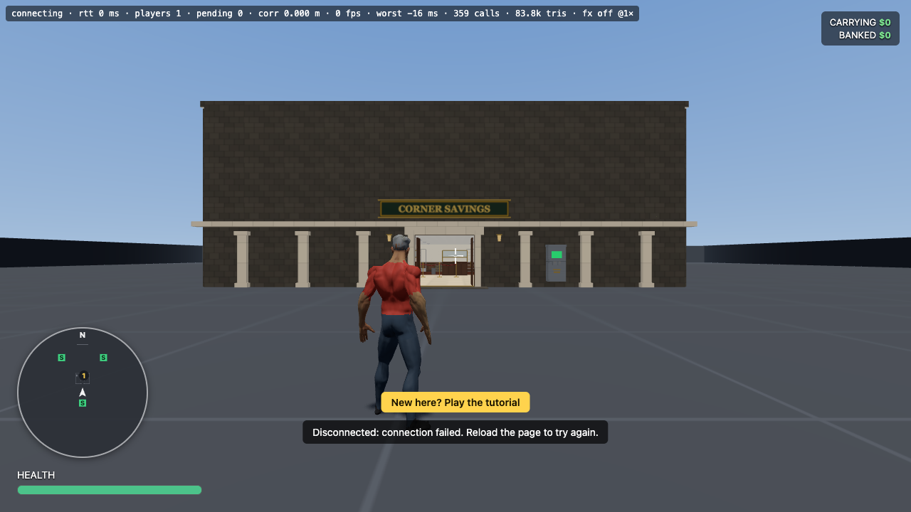 |
| 2 | Street front from the side | `?map=heist&hour=12&at=9,14,0,0.5` | 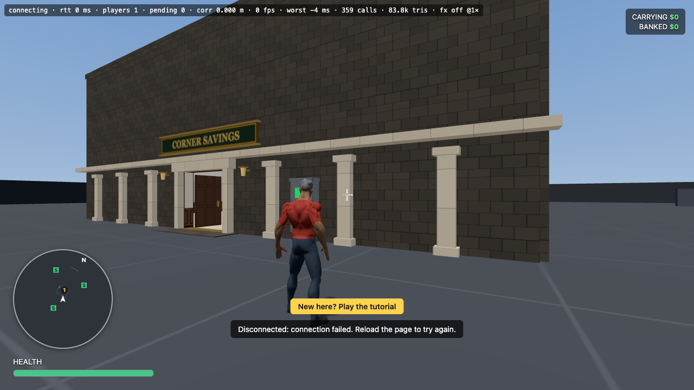 |
| 3 | The doorway | `?map=heist&hour=12&at=0,13,0,0` | 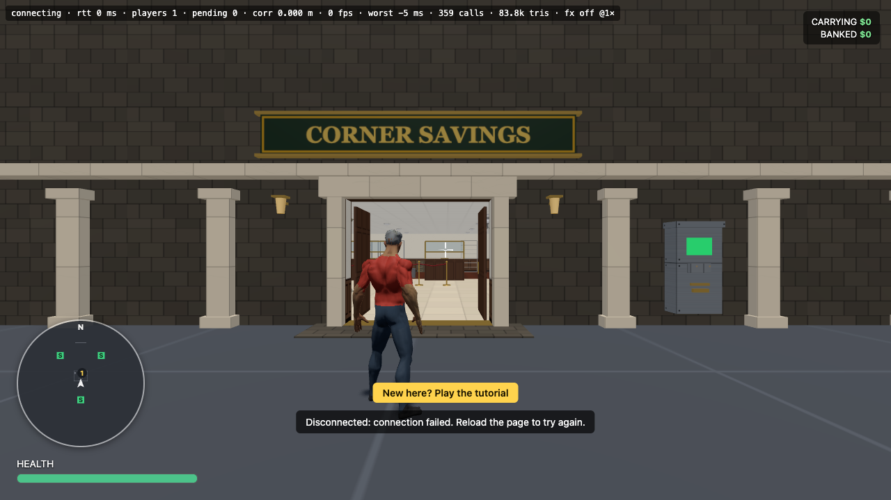 |
| 4 | Lobby: queue, columns, teller screens | `?map=heist&hour=12&at=4,5.5,0,0.7` | 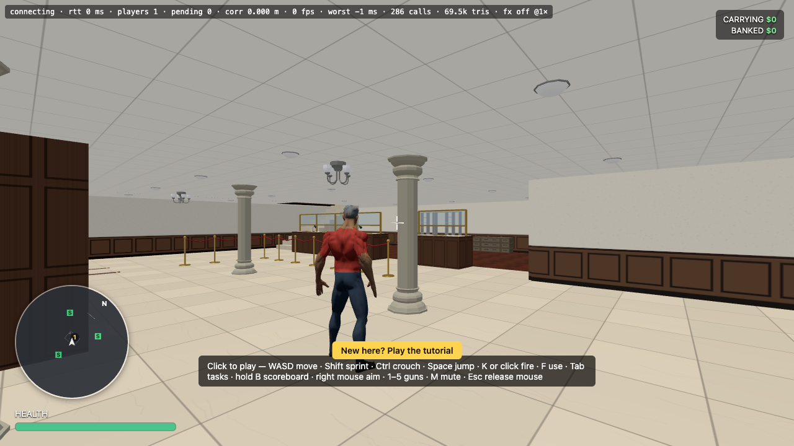 |
| 5 | Lobby: waiting corner | `?map=heist&hour=12&at=0,5,0,1.4` | 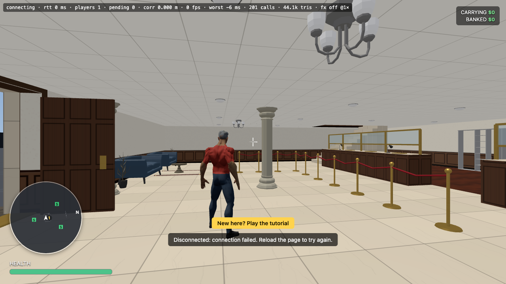 |
| 6 | Behind the counter | `?map=heist&hour=12&at=-4,-5,0,3.14` | 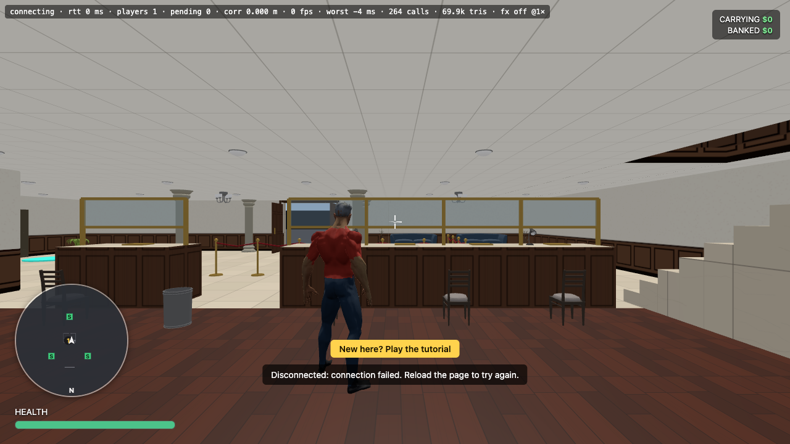 |
| 7 | Security room | `?map=heist&hour=12&at=8,-5,0,1.8` | 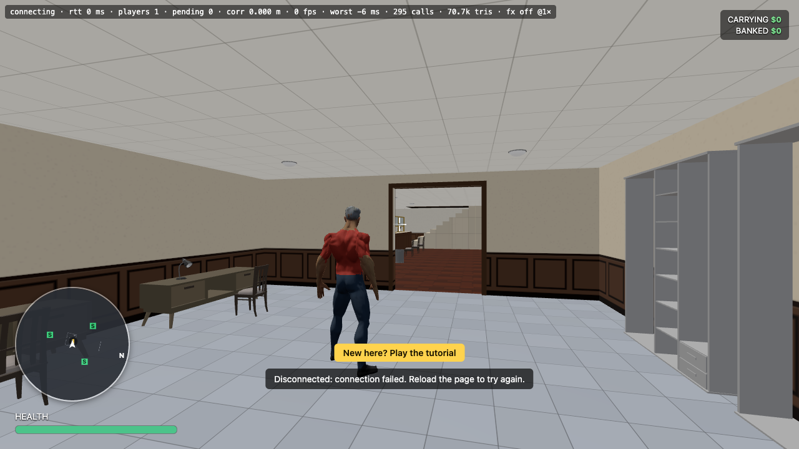 |
| 8 | Storey 1: open-plan office | `?map=heist&hour=12&at=10,-0.5,3,1.6` | 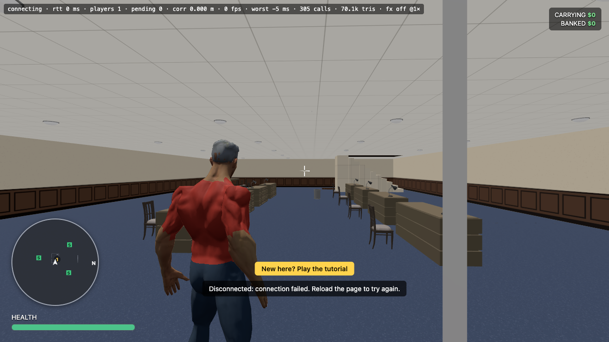 |
| 9 | Storey 2: boardroom | `?map=heist&hour=12&at=2,0.5,6,2.3` | 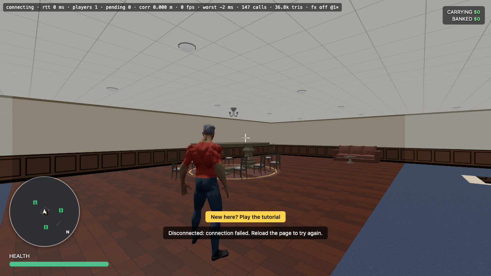 |
| 10 | Vault door, shut | `?map=heist&hour=12&at=0.6,-5.3,6,-1.57` | 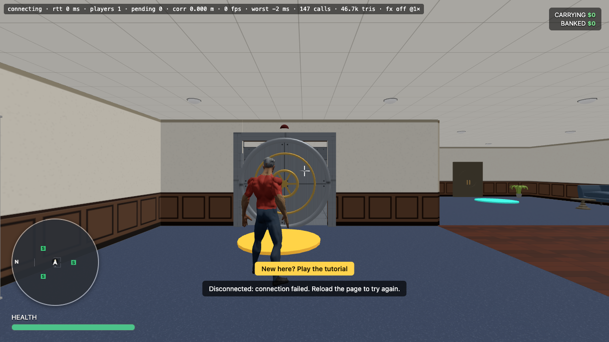 |
| 11 | Inside the vault | `?map=heist&hour=12&at=7,-6,6,3.14` | 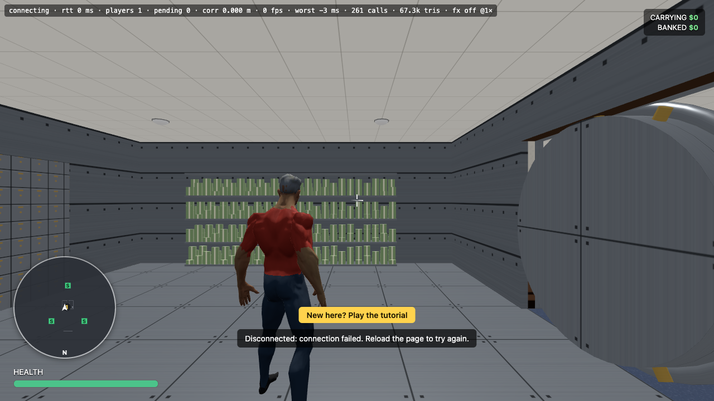 |
| 12 | A lock cracking (sparks, amber keypad, alarm) | add `&vaultdemo` to #10 and wait ~8 s | 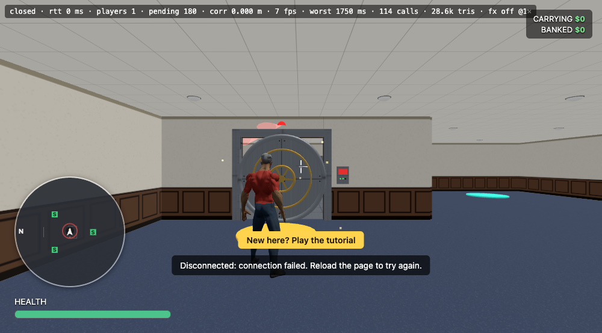 |
| 13 | The door swinging open | same, wait ~13 s | 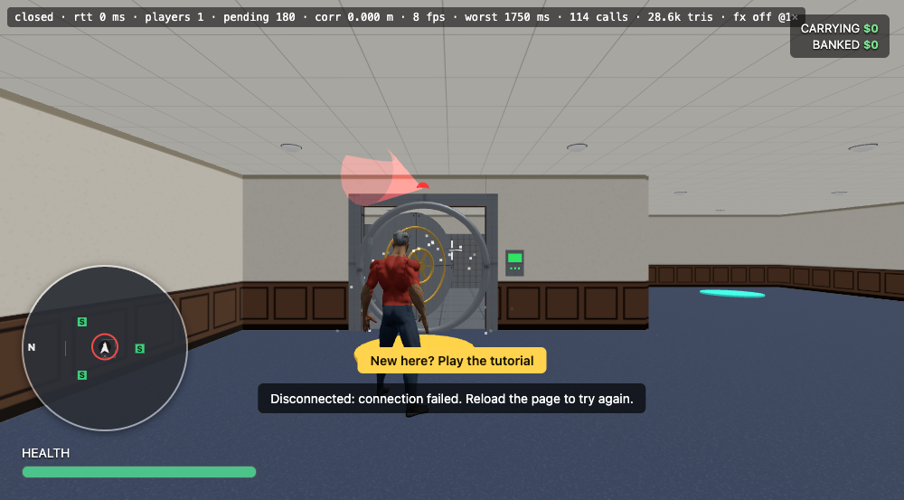 |
| 14 | Front at night | `?map=heist&hour=22&at=2,16,0,0.2` | 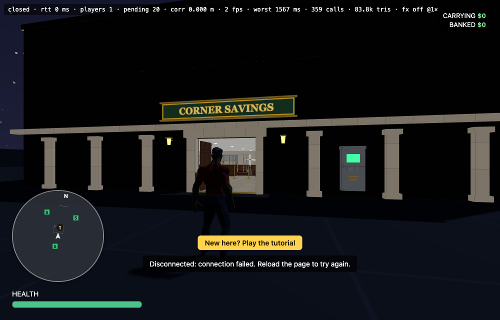 |
| 15 | Vault cash shelves | `?map=heist&hour=12&at=7,-6,6,3.14` (turn round) | 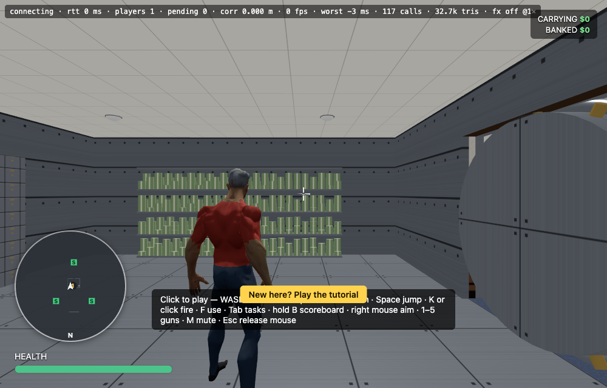 |

## Walk-through (what a crew sees)
1. Stone front with six marble pilasters, a plaque, two lanterns and an ATM; the doors are propped open.
2. A marble lobby with columns and chandeliers: a red-rope queue before a panelled counter with glass screens; a waiting corner with couches and a rug; lift doors on the east wall.
3. Behind the counter, a wood-floored staff area with chairs, lamps and ledger shelves; east of it a tiled security room.
4. Stairs up to an open-plan office (desks, files, a meeting table), then on to the executive floor: a wood-floored boardroom, a lounge.
5. The vault: a round steel door with a brass wheel and twelve bolts, a keypad and an alarm light. Each cracked lock turns the wheel and draws that lock's bolts; the last swings the door open. Inside: deposit-box walls, cash shelves, steel floor and walls.

## What I think is weakest (please push back or add)
- **Desks.** The office "desks" are the pack's drawer cabinets: they read as low dressers, not desks (no legs, no monitor).
- **Walls are bare.** No windows, no pictures or notices, and no door leaves on the interior doorways.
- **Ground floor behind the counter** is a wood-floored room with no wall between it and the lobby except the counter; it works but there is no teller-area door.
- **Cash bundles** have a visible repeating band.
- **Vault door** has no real frame depth (it sits flush in the wall), and the alarm beam is faint by day.
- **Lighting** is flat: every room lights itself evenly, so there is no mood (no pools of light under lamps, no darker back rooms).
- **Chairs are not solid**, so you walk through them.
- Street ATM and columns are not solid (art only).

## Questions for you
1. Should I fix any of the above before rolling out to Banks 2–5 (11.9)? Which matter most?
2. For Banks 2–5, should the look climb with the tier (marble and gold at tier 5, plainer at tier 2), as planned?
3. Anything you want in the lobby or vault that is missing (e.g. a vault safe-deposit counter, security cameras, a money counting room)?
