# Banks 2–5 — roll-out (11.9)

Same kit, same builders as Bank 1, a richer look each tier. Screenshots are from headless Chrome on the `city` map (software rendering, so frame rates in the overlay mean nothing). Open any of them live with `?map=city&hour=12&at=x,z,y,yaw`.

| Tier | Bank | Outside | Public rooms | Upstairs | Details |
|---|---|---|---|---|---|
| 1 | Corner Savings | grey ashlar | marble lobby, wood behind the counter | carpet, panelling | the showcase (see bank-1.md) |
| 2 | City Trust | warm sandstone | tiled lobby, wood and panelling behind the counter | carpet, panelling; wood executive floor | two pillars, a waiting corner each side |
| 3 | Metro Capital | dark granite | marble hall with chandeliers | wood floors, panelling | columns, a hall of ledgers |
| 4 | Grand Reserve | pale limestone | marble hall, four columns, three chandeliers | wood offices, records room with shelves all round | executive floor with a boardroom |
| 5 | Federal Vault | white marble | marble floor and marble walls with a gold-trimmed dado | wood, carpet; marble top floor | eight pilasters, six chandeliers, a boardroom in front of the vault |

| View | Image |
|---|---|
| Bank 2 front | 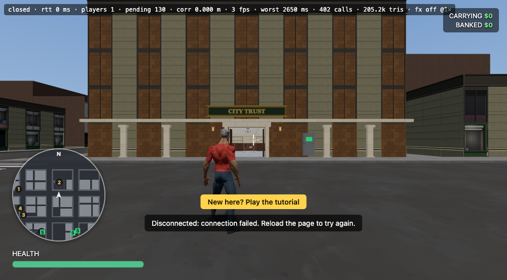 |
| Bank 2 lobby | 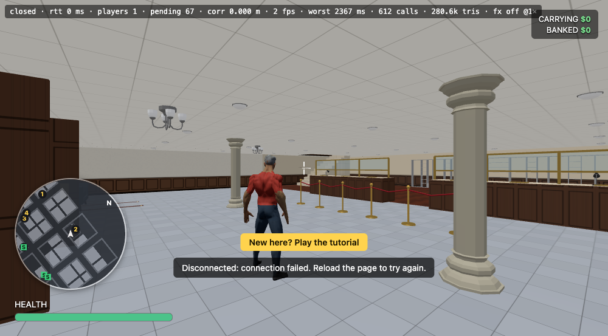 |
| Bank 2 offices (storey 1) | 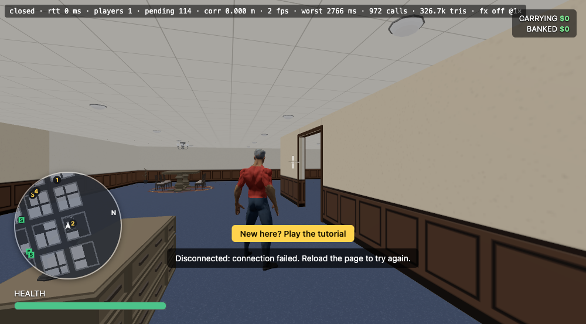 |
| Bank 3 front | 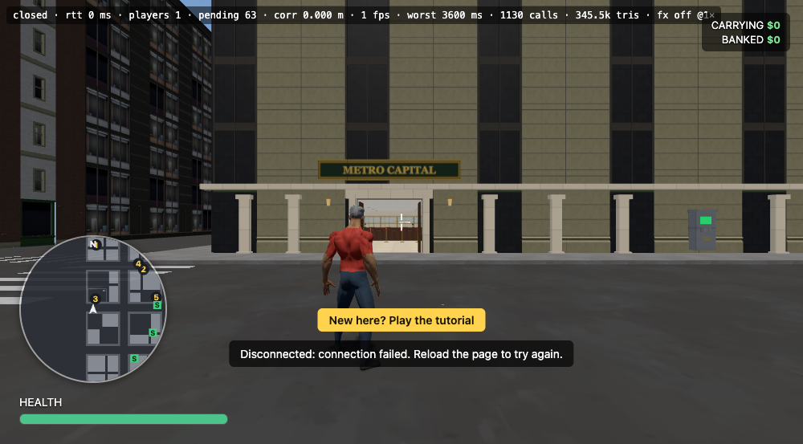 |
| Bank 3 hall | 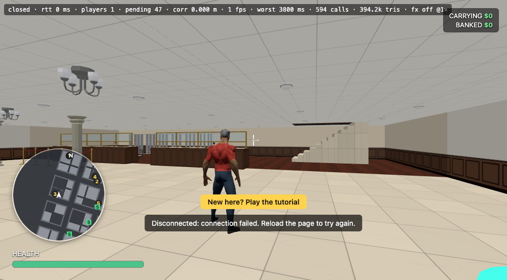 |
| Bank 3 executive floor | 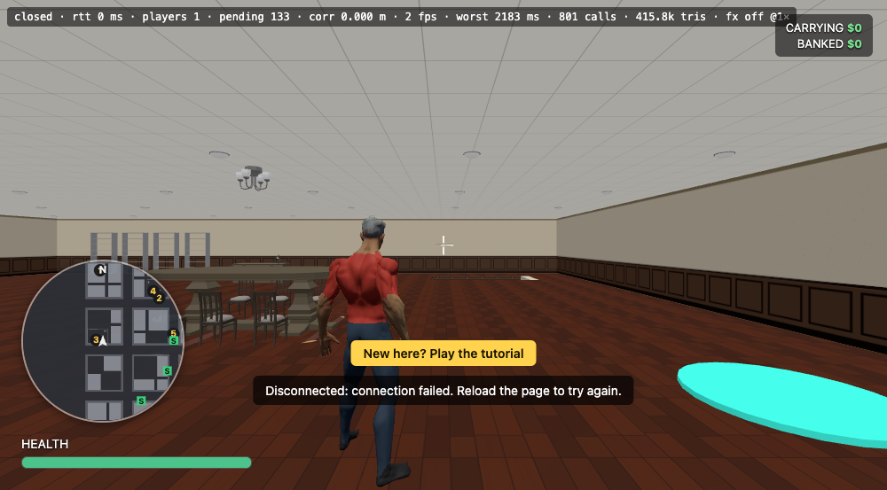 |
| Bank 4 front | 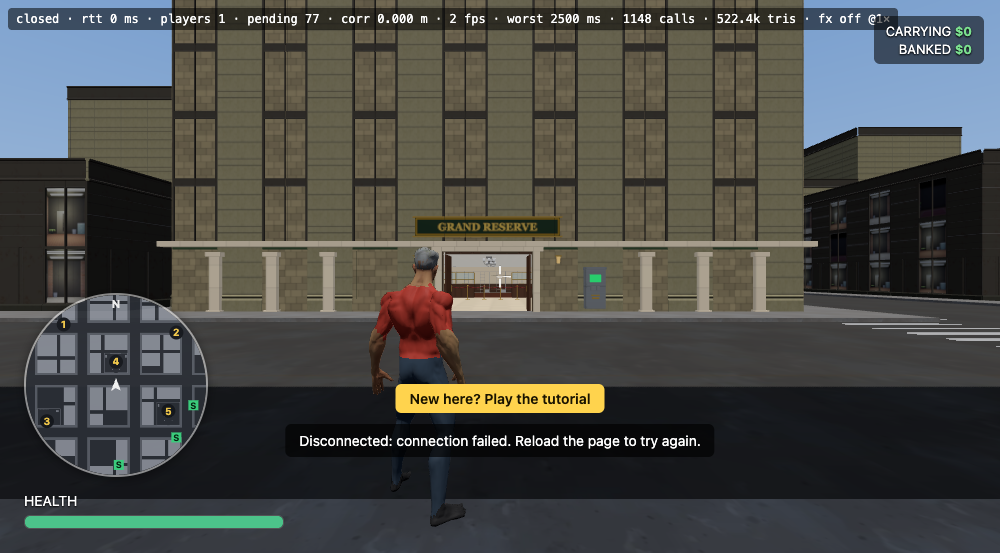 |
| Bank 4 hall | 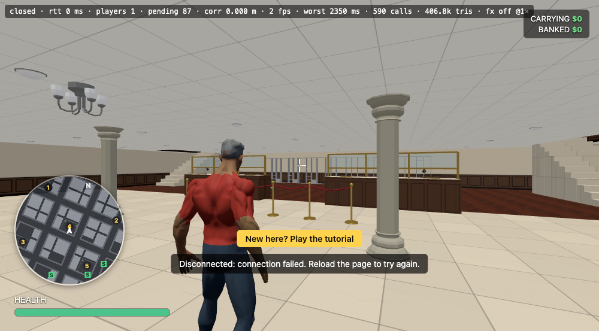 |
| Bank 4 vault, from inside | 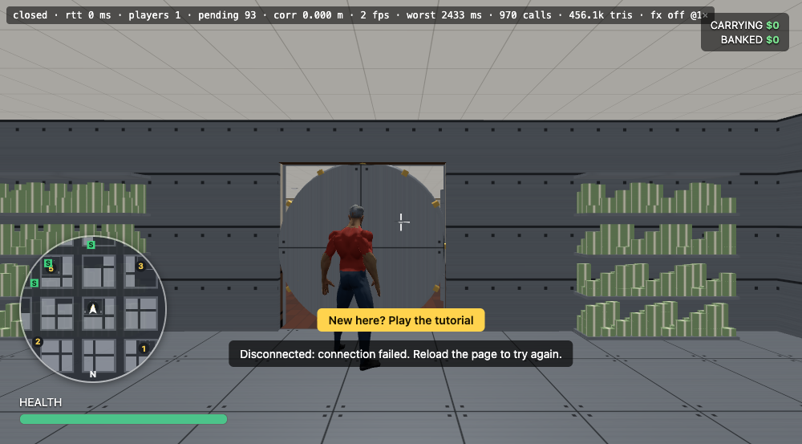 |
| Bank 5 front | 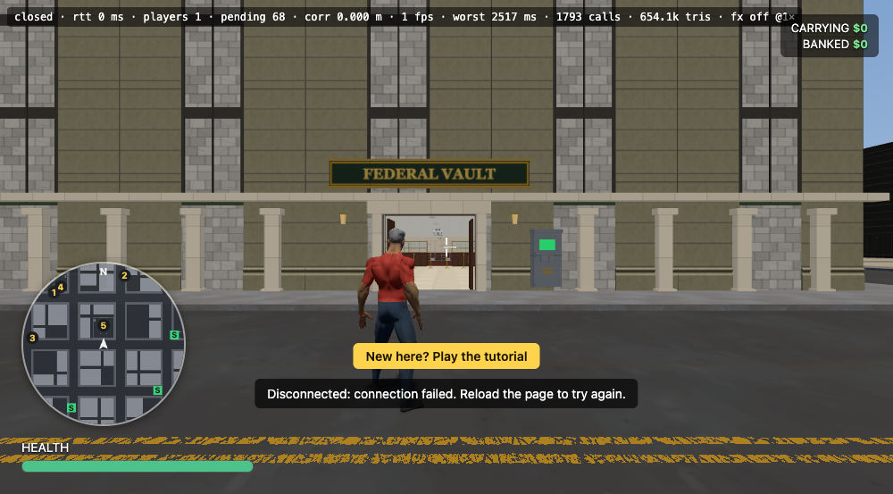 |
| Bank 5 hall | 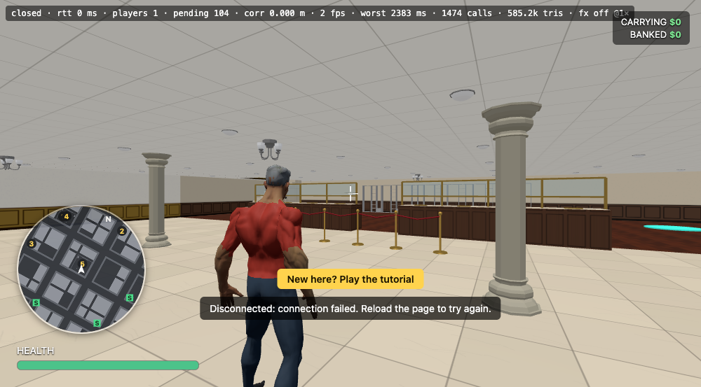 |
| Bank 5 top floor, vault door | 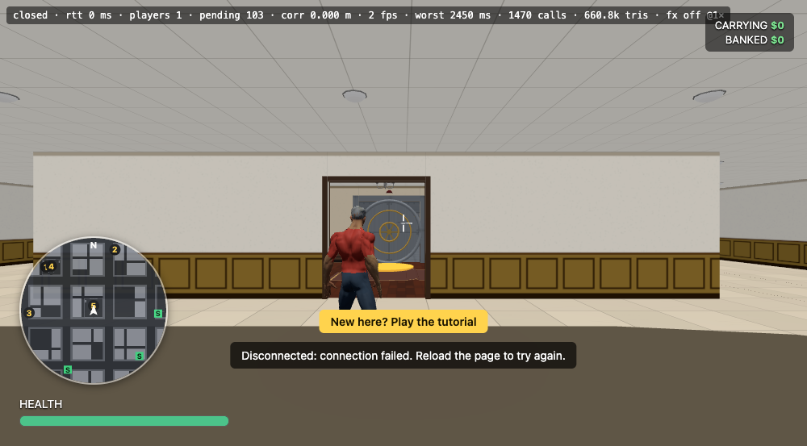 |

**Shared weak spots, fixed for all five banks:** desks now have tops, monitors and keyboards; the outside walls have framed windows and pictures; the light is no longer flat (pools under lamps, soft shadows under furniture).

| After | |
|---|---|
| Offices | 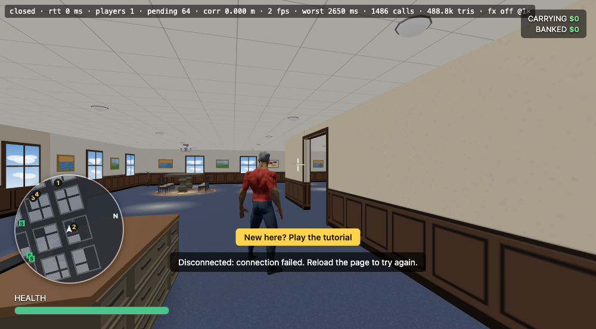 |
| Hall | 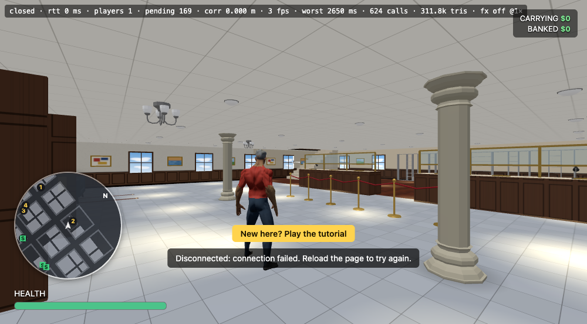 |

Still open from the Bank 1 list: the vault door has no frame depth, the cash bundles' band repeats, chairs and the street cash machine are not solid, interior doorways have no door leaves.
