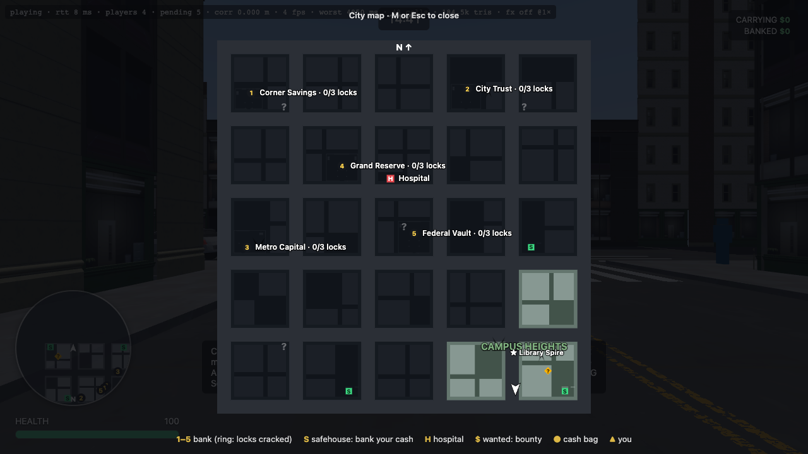
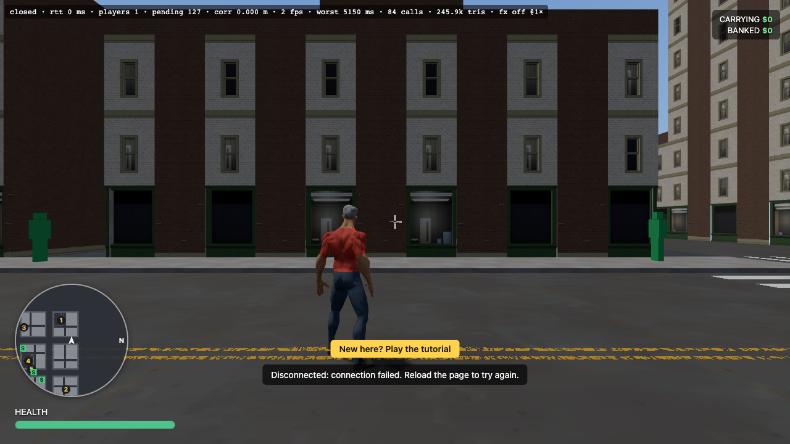
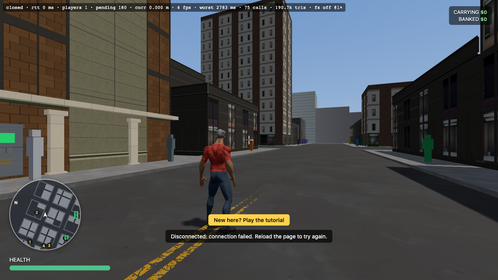
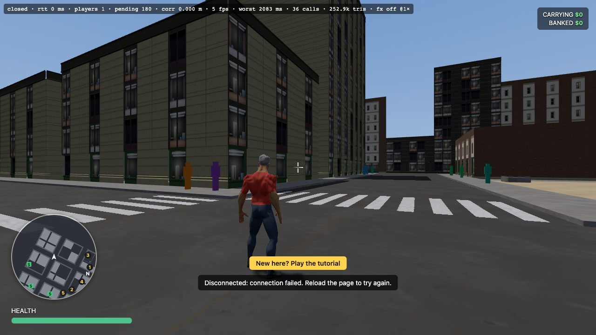
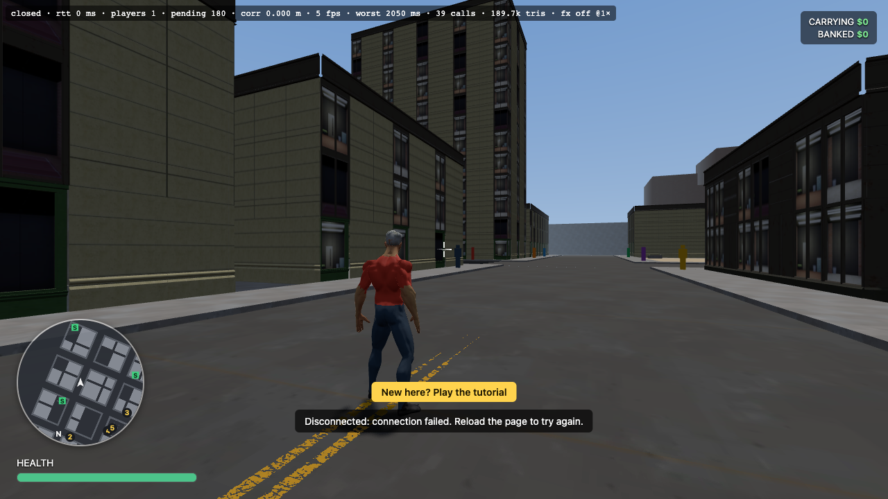
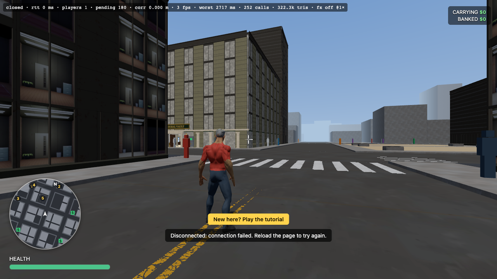

# Exploration and freedom — review (30.8)

The GTA audit scored **Exploration 3/10** and **Freedom 5/10** before Phase 30. This re-scores both after 30.1–30.7. It is the author's own assessment from the code, tests and screenshots; the playtest-backed score of every pillar is 36.1.

Screenshots: headless Chrome, software rendering (frame rates mean nothing). The district street views are offline (`?map=city&hour=12&at=x,z,y,yaw`), because a live server puts you back at a spawn; the map is from a fresh join.

| View | Image |
|---|---|
| Full map on a fresh join: only the spawn district (Campus Heights) is uncovered, the rest is under fog with a `?` |  |
| Old Town (brick) |  |
| The Docks |  |
| Market Row |  |
| Campus Heights |  |
| Financial District |  |

## What changed since the audit

| Pillar | Before | Now | Evidence |
|---|---|---|---|
| Exploration | five banks, three safehouses, one grid | five named districts, each with its own facade family, a landmark tower and a colour (30.1); hidden cash caches in a new place every round (30.2); 24 collectible data chips with SQL trivia kept per student (30.3); a full map that stays under fog until you walk into a district, kept per student (30.5) | the map shot; `generateCity`, `CacheSystem`, `CollectibleSystem`, `DiscoverySystem` tests |
| Freedom | one way to rob a bank | choose stealth or loud, each with its own payoff (30.7); two side jobs, a delivery and a car race, that end in a SQL question (30.6); lasting upgrades bought with banked cash (30.4); shops (29.6) | `Approach.test.ts`, `JobSystem.test.ts`, `UpgradeSystem.test.ts` |

## Scores

**Exploration: 8 / 10.** There is now a reason to leave the bank: a place to find, a thing to collect and a map that rewards walking it. What keeps it from 9: the districts differ in facade family but not yet in street furniture or ambient life, so the difference is clear on the map and in the buildings but less so at street level (see the street shots: Old Town reads as brick, the others less distinctly); caches and chips are found by walking, not yet by the intel jobs of Phase 33; and there are only five districts.

**Freedom: 8 / 10.** Two real approaches to the main task, jobs that do not involve a bank at all, and persistent upgrades. What keeps it from 9: the stealth approach has one rule (seen or not) and no tools such as distraction or disguise; jobs are two kinds and repeat; nothing yet lets a student change the city.

## Caveats

- Everything here is checked by server tests, not by a playtest. Whether stealth feels fair, whether the race is fun, and whether the fog map invites exploring are for a human to say (36.1).
- Landmark towers are visible in the code and the map but not framed in these still shots.
- The jobs' SQL step reuses ordinary question tiers; a teacher can retune them under the reward tiers like any other reward.
