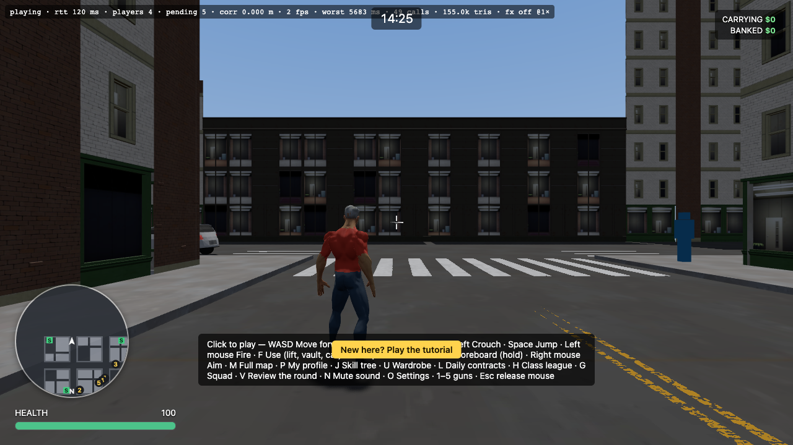
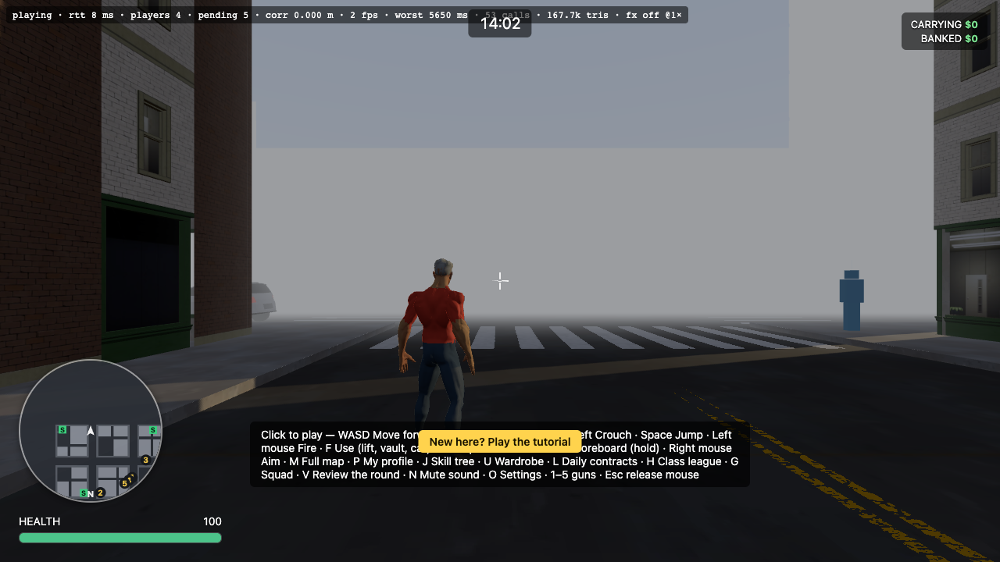
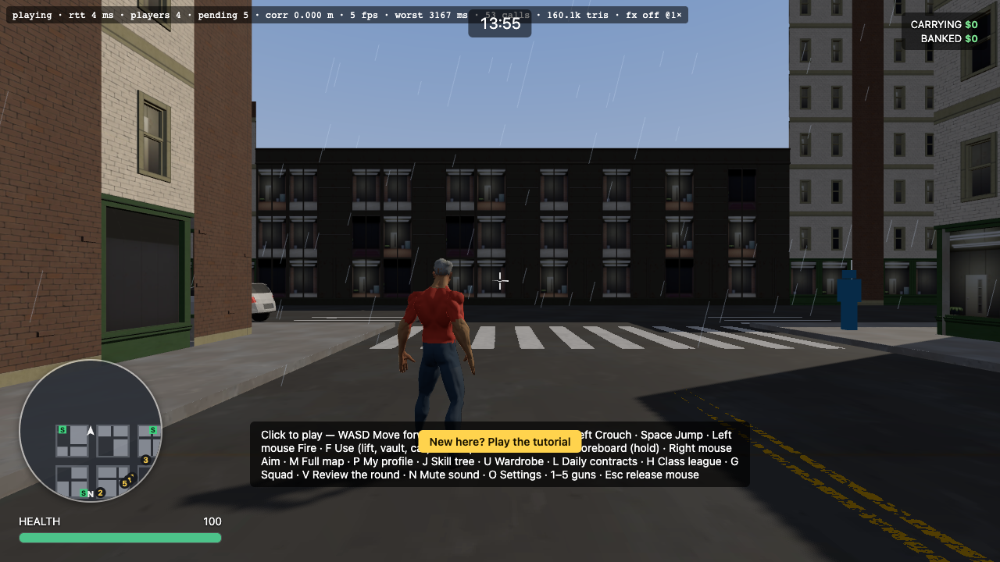
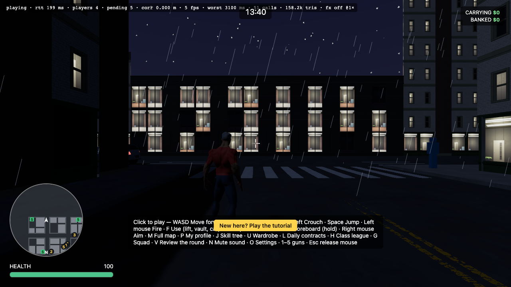

# World immersion — review (29.8)

The GTA audit scored World immersion **5/10** before Phase 29. This is the re-score after 29.1–29.7. It is the author's own assessment from the code, the tests and the screenshots below; the playtest-backed re-score of all eight pillars is 36.1.

Screenshots: headless Chrome on the `city` map through `/?play&hour=…&weather=…` against the live dev server (software rendering, so the fps in the overlay means nothing; draw calls and triangles do).

| View | Image |
|---|---|
| Street, noon, clear |  |
| Street, afternoon, fog |  |
| Street, afternoon, rain |  |
| Street, night, storm |  |

Draw cost in those four views: 49–53 calls, 155–168k triangles (budget: 700 calls, 900k triangles).

## What changed since the audit

| Part | Before | Now | Evidence |
|---|---|---|---|
| People | empty streets | 300 strolling pedestrians that flee gunfire (29.1) | one visible at the right edge of the street shots; model and renderer tests |
| Traffic | parked cars only | 24 self-driving cars with lights, turns, crash reactions (29.2) | `Traffic.test.ts` in the real city |
| Danger | only other students | bank guards and a police response with wanted stars, pursuit and roadblocks (29.3–29.4) | `GuardSystem.test.ts`, `PoliceSystem.test.ts` |
| Sky | day and night only | fog, rain and storms, shared by every player, with rain sound and a harder wind (29.5) | the four screenshots; `weather.test.ts` |
| Places to go | banks and safehouses | a shop beside every safehouse (29.6) | `ShopService.test.ts` |
| Sound | wind and sirens | rain, storm wind, a three-station car radio (29.5, 29.7) | `GameAudio.test.ts`, `synth.test.ts` |

## Score: 8 / 10

What earns it: the city is no longer empty or static. There are people, cars, armed staff, police and weather, they react to what the player does, and everything costs a small fixed amount of draw time (two draw calls for the crowd, one for rain).

What keeps it from 9:
- **Not seen in motion.** The screenshots are still frames in software rendering. Traffic, guards and police are proven by server tests, not by watching them; a human playtest should confirm the pursuit looks fair and the cars look natural.
- **Pedestrians are plain.** The crowd far-LOD is a single box and the near model has one shape, so a close look gives away that it is a crowd of few kinds.
- **No interiors for the shops**, only a counter and a coloured marker.
- **Sky and fog.** In thick fog a faint edge of the sky dome shows above far buildings.
- **No lights or sirens on police**, and no police cars; officers arrive on foot.

## Next, if a pillar needs more than 8

1. Police vehicles with lights and sirens (reuses the traffic driver).
2. Three or four more pedestrian models and clothing colours.
3. A shop canopy and sign.
