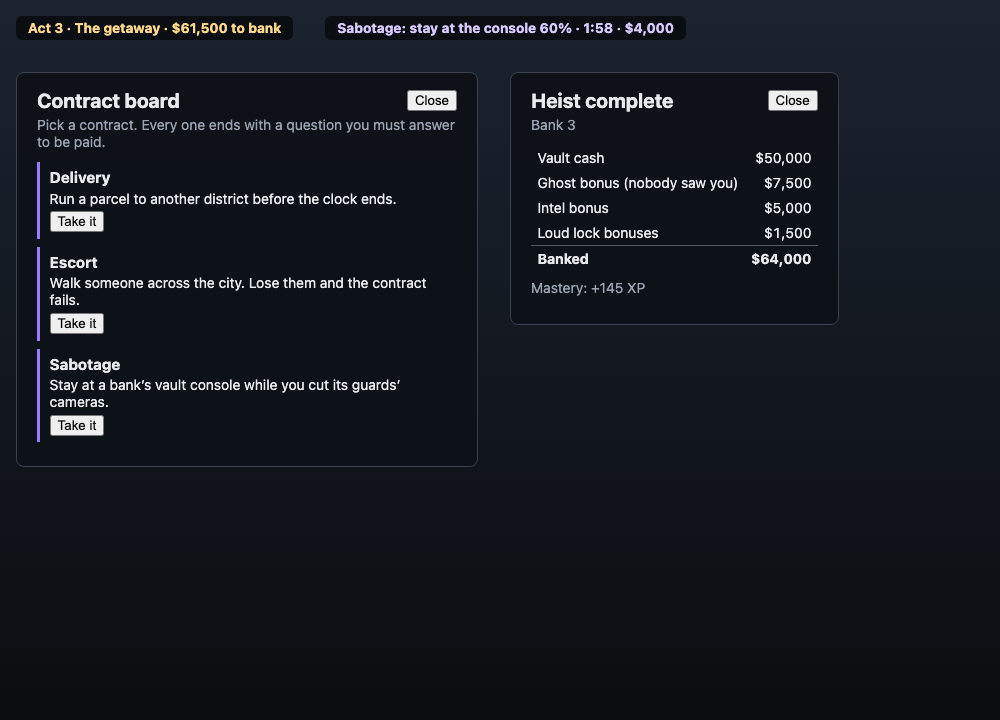

# Missions and heist structure — review (31.5)

The GTA audit scored **Missions 3/10** before Phase 31: one task (crack the vault) with nothing before or after it. This re-scores it after 31.1–31.4. It is the author's own assessment from the code, the tests and the screenshot; the playtest-backed score of every pillar is 36.1.

The screenshot is the real game components with sample data (open `missions.html` on the client dev server; it is not part of the build): the act line, a contract in progress, the contract board and the payout screen.

## What changed since the audit

| Part | Before | Now | Evidence |
|---|---|---|---|
| Structure | crack the vault, take the cash | three acts: setup (intel terminal outside each bank), the heist, the getaway (31.1) | `ActsSystem.test.ts`, run end to end |
| Choice of work | none | a contract board in every district with six kinds: delivery, race, recon, sabotage, data theft, escort (30.6, 31.2) | `JobSystem.test.ts` |
| Consequence | the same getaway every time | the police guess the way to the nearest safehouse and block it; your intel shows you the roadblock, and full intel thins it (31.3) | `Getaway.test.ts` |
| Reward | cash on the floor | a payout screen with the take's parts, and mastery XP (31.4) | `ActsSystem.test.ts` |

## Score: 8 / 10

What earns it: a heist now has a beginning, a middle and an end, each with its own work; there is a reason to prepare, and the preparation changes what happens later (guards on the map, a shorter alarm, a bigger take, a visible and thinner roadblock); and there is work to do between heists that all runs through the one rule of the game (a SQL question answered correctly).

What keeps it from 9:
- **Intel is one question at a terminal.** It is an honest setup job but not yet a puzzle in itself; Phase 33 turns intel into queries over the live city.
- **Contracts repeat.** Six kinds, picked at random targets, with no story between them (Phase 32).
- **Not played through.** Every act, contract and payout is proved by server tests, but nobody has played a full session to see whether the pace is right, or whether the payout feels earned.
- **The payout is a list.** It names the parts of the take, but does not yet compare to the last run or to the class.

## Caveats

- The review screenshot shows components with sample numbers, not a live session.
- The squad split of a take is not in the payout (squads share the round table, not a single heist's cash).
