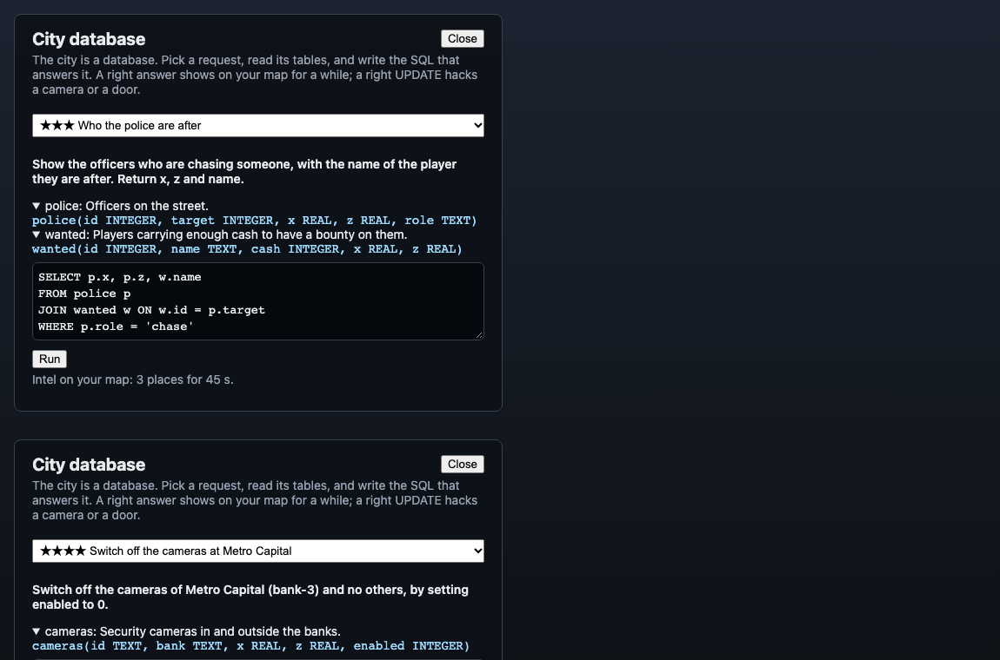

# SQL fit — review (33.6)

The GTA audit scored **SQL fit 4/10** before Phase 33: SQL was how you opened a lock, heal or gun, but the *world* was not made of data, so the skill and the game sat side by side rather than together. This re-scores it after 33.1–33.5. It is the author's own assessment from the code, the tests and the screenshot; the playtest-backed score is 36.1.

The screenshot is the real terminal with the default requests (open `citydb.html` on the client dev server; it is not part of the build): a joined query that was right (intel for 45 s), and an UPDATE that was wrong (it switched off other banks' cameras too).

## What changed since the audit

| Part | Before | Now | Evidence |
|---|---|---|---|
| The world as data | none | seven live tables (guards, cameras, cash, wanted, police, banks, doors) built from the match's own state (33.1) | `Intel.test.ts` |
| SQL that does something | a question opened a lock | a SELECT puts guards, cash and police on your map; a joined one labels them; a harder one keeps them longer (33.2, 33.3) | `Intel.test.ts` |
| SQL that changes the world | none | an UPDATE switches a bank's cameras off, or has a vault door open its next lock (33.4) | `Intel.test.ts` |
| Fair | n/a | try gap, per-request cooldowns, a range, a pin cap, hostile SQL refused, the answer never sent (33.5) | `Intel.test.ts` |

## Score: 8 / 10

What earns it: for the first time the skill is the tool. To see the guards of a bank you *select* them; to see who the police are after you *join*; to switch a camera off you *update* the right rows and no others; and the better the query the better the payoff. The world is the dataset, so the questions are never about an invented company: they are about the game the student is standing in. It plugs into the existing sandbox (read-only authorizer, row caps, timeouts in production), so it adds no new way to break the server.

What keeps it from 9:
- **Requests are set questions.** A student answers "show the guards of Metro Capital", not "find something useful". Free exploration of the tables (a real query console with a cost) would be a bigger step; it is held back for fairness, because an open `SELECT *` would give everything for nothing.
- **Twenty-two requests are mostly alike.** The camera and door requests differ only by bank; the intel ones are seven shapes. More shapes (a subquery, a window) would teach more.
- **The intel is positions only.** No history ("where was the guard a minute ago"), which is where a log table and `ORDER BY time` would come in.
- **Balance is untested with students.** Whether intel makes a heist too easy, or the door hack too strong, is for a playtest (36.1). The limits are conservative (tier 5, 150 s wait, only the next lock).
- **Not seen in play.** The screenshot is the terminal with sample answers, not a heist.

## Caveats

- The terminal is a text box, not the full editor the question panel uses (no highlighting, no run-to-preview). A free preview of the student's rows would need care so it does not hand out the intel.
- A wrong try returns the same hints a question does (counts and shapes, never values).
