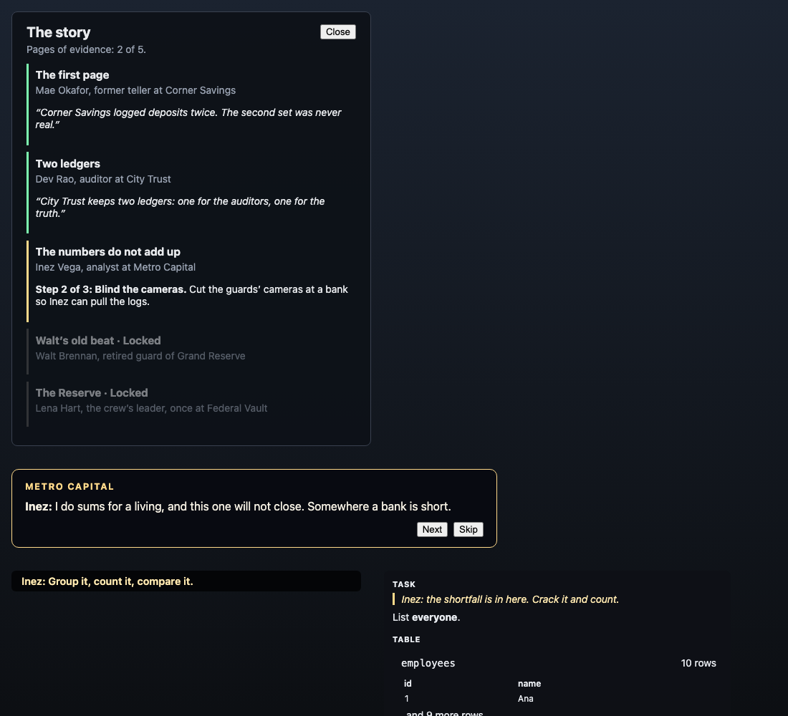

# Story and characters — review (32.5)

The GTA audit scored **Story 1/10** before Phase 32: there was no story at all. This re-scores it after 32.1–32.4. It is the author's own assessment from the code, the tests and the screenshot; the playtest-backed score of every pillar is 36.1, and the story itself is waiting for the owner's approval (`docs/story.md`).

The screenshot is the real game components with the default words (open `story.html` on the client dev server; it is not part of the build): the journal with two chains done, one active and two locked; a scene playing; a fixer's line; and a question under the crew's line.

## What changed since the audit

| Part | Before | Now | Evidence |
|---|---|---|---|
| A world and a cast | none | a premise, a crew of five fixers (one per bank), and an antagonist who never appears but signed every false entry (32.1) | `docs/story.md`, `story.test.ts` |
| An arc | none | five chains that unlock in order and climb with the tiers, each giving a page of evidence (32.2) | `StorySystem.test.ts` |
| Story in play | none | each chain is intel, a contract and the heist, so the story is made of what the player already does; progress is kept per student (32.2) | `StoryStore.contract.test.ts` |
| Voice | none | scenes open and close each chain and can be skipped; fixers speak at eight moments in a heist (32.3) | `StoryVoice.test.ts`, `SceneView.test.ts` |
| Questions in the story | none | every story question sits under one line from the crew (32.4) | `ChallengeService.test.ts` |

## Score: 8 / 10

What earns it: a student now has a reason for every heist (a page of a case), someone to do it for (a fixer with a manner and a reason), a shape (five steps up in difficulty, ending on the one who did it) and a voice at the moments that matter. All of it is data in one place, so a teacher can rewrite it, and none of it gets in the way: scenes are short and skippable, barks are spaced, and a student who ignores the story loses nothing.

What keeps it from 9:
- **The words are a first draft.** They are plain and serviceable, written by the author of the code, and have not been read by a teacher or a student. The owner must approve the story (32.1) before this score means much.
- **The 268 question bodies are not rewritten.** Each question carries one line from the crew, but its own situation (a payroll leak, a library) is whatever it always was. That is a content job (`docs/inputs-needed.md`).
- **The villain never appears.** Marcus Vale is a name on a page; a face, a scene of his own or a fight would pay off the arc.
- **Scenes are text on a panel.** No portraits, no camera, no voice.
- **English only.** The Hindi translation of every line is still to do.

## Caveats

- The screenshot is components with the default words, not a session.
- Whether the story lands with an eleven-year-old, or with a Year 12, is for a playtest to say (36.1).
